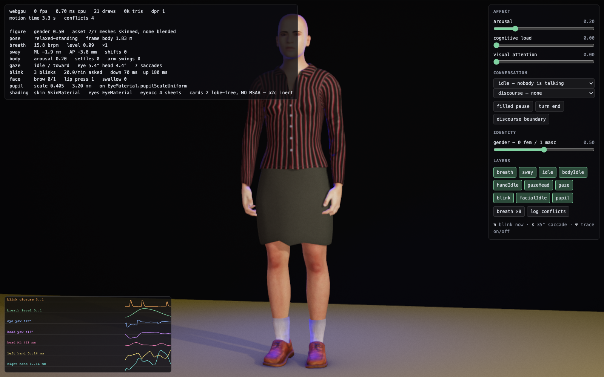
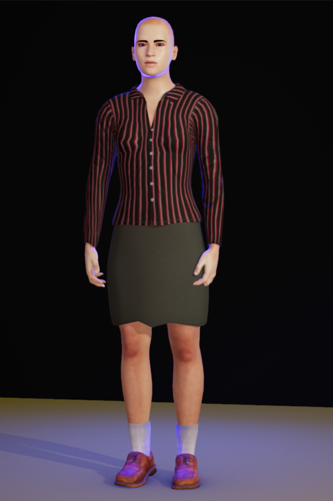
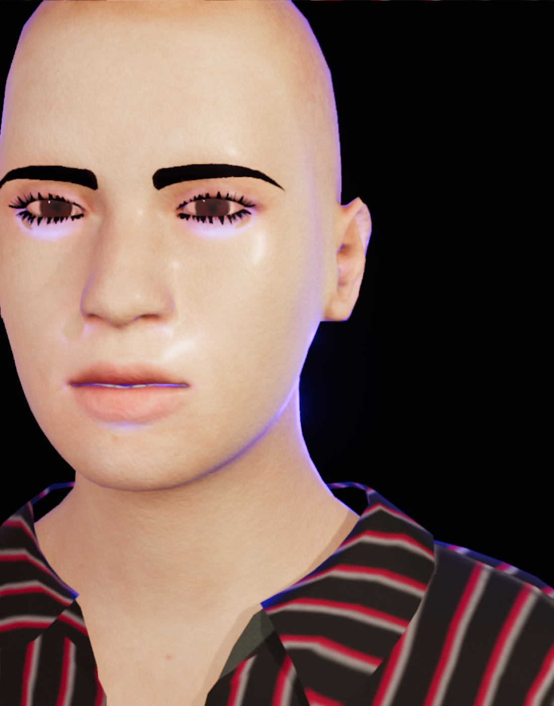

# 姿 Sugata

**A body for an AI.** Real-time WebGPU avatar that feels what it reads and moves its whole body to show it.

## External dependency — Ember character authoring

**Ember's character studies use external authoring tools and assets: Blender/MakeHuman/MPFB, plus KeenTools FaceBuilder and its proprietary Core for the retained photo-guided head study.** These dependencies are outside Sugata and must remain disclosed. Robert installed FaceBuilder and approved one free trial on October31,2026. Its fitted head and projected texture were exported and reviewed; they are preserved as a comparison, not a completed avatar.

The current measured-fitting experiment uses Sugata's existing MakeHuman-derived identity controls with manually checked portrait observations. One candidate and one correction have been rendered; the corrected native head is retained for a fitted-eye and early-animation probe. This is not complete automatic photo reconstruction. **Ember likeness, AAA finish and complete animated integration are not yet accepted.**

Reproducing the FaceBuilder study requires Blender, a separate FaceBuilder/Core installation and valid authoring access. Its ordinary exported mesh can be reviewed without FaceBuilder. Preserve provenance with any resulting character; do not present externally authored results as Sugata-only generation. No purchase or subscription is authorized.

See the central [character-authoring dependencies and provenance register](docs/AUTHORING-DEPENDENCIES.md) for roles, licensing, installation status and result limits. [Current Ember work](docs/EMBER-AVATAR-NEXT.md).



## One call

```js
import { Avatar } from './packages/core/src/Avatar.js';

const avatar = await Avatar.create( { canvas: document.getElementById( 'stage' ) } );
```

That is the whole setup. The figure comes back breathing at 15 to 16 breaths a minute, blinking on a
Poisson schedule, running saccades with real main-sequence velocities, and shifting its weight the
way a standing person does.

```js
avatar.feel( 'angry', 0.9 );          // the face and the whole body
await avatar.say( 'I am glad you came back.' );
await avatar.setIdentity( { gender: 0.2 } );
```

## Emotion reaches the body, not just the face

Most avatars emote from the eyebrows up. This one uses all three PAD axes, so anger and fear separate
where a face cannot separate them.

| `feel()` | trunk | arms | dominance |
|---|---:|---:|---:|
| `'angry'` | **+17.99°** forward | −38.32° drawn in | +0.91 |
| `{ pleasure: −0.9, arousal: 0.8, dominance: −0.8 }` | **−3.53°** back | 0° | −0.78 |
| `'happy'` | 0° | **+25.43°** open | +1.00 |

Anger and fear carry identical pleasure and identical arousal. Only dominance tells them apart, and
the trunk goes opposite ways. Those numbers are measured off the rig, not authored.

## Talk to it

Point it at any OpenAI-compatible endpoint and it appraises what you say, feels it, and answers.

```bash
npm run dev
# open http://localhost:5173/src/converse.html with LM Studio running
```

Affect arrives in two tiers. A lexicon and prosody pass runs in under a millisecond so the face moves
before the sentence finishes. An LLM pass follows about a second later and blends in, so the
correction settles instead of popping.

## It is one figure, at any point between

 

`gender` is continuous from 0 to 1. Skin is pre-integrated subsurface scattering with a baked
curvature map, dual-lobe specular and a tiled micro-normal. Eyes are two nested shells with real
corneal refraction. The wardrobe layers garments, hides covered geometry, and retains the selected
foundation when an outer outfit is removed. Current fit and coverage limits are recorded with each study.

## Requirements

- **A browser with WebGPU.** WebGL2 runs at a reduced tier and the API reports which one it chose.
- **Node `^20.19 || >=22.12`** and `git-lfs`. The figure bakes are 232 MB of LFS objects. Clone
  without LFS and you get pointer files, not a body.
- **An OpenAI-compatible LLM endpoint** for the conversation page only. Other browser avatar features do not require that endpoint.

```bash
git lfs install
git clone https://github.com/tokenfires/sugata-avatar.git
cd sugata-avatar && npm install && npm run dev
```

## Status

The runtime combines skin, eyes, lighting, blink, gaze, breath, sway, affect-driven posture,
gestures, IK and supplied viseme timelines. Opt-in wardrobe and `avatar.dress()` now work through
the public `Avatar` runtime on the midpoint g050 body. Detailed identity sculpting remains in
dedicated modules/testbed pages. Real TTS and microphone input remain open. `say()` without a supplied timeline does not animate
speech on its own.

The **portrait study** puts expressions, lighting, camera control and two haircuts on one page.
Run `npm run dev`, then open `/src/portrait.html`. The chin-length `bob02` falls alongside the
cheeks with its shake preserved. The original long `bob01` now has a corrected g050 shape and
nape contact path, verified across the recorded motion poses. Other bob01 bakes retain their
existing shapes. Broad card patches, mottled highlights and some contacts outside the corrected
regions remain; finer strand rendering is still an experiment.

The studio shadow filter now softens the card-shaped neck/chest patches while retaining depth.
The [shadow comparison](docs/SHADOW-SOFTNESS-2026-09-13.md) covers both bobs in motion and full outfits;
tee neckline finish and broader character appearance remain open.

Portrait and Wardrobe studies now offer **Look toward me**, **Look with a smile**, and **Release**.
The experimental action uses native measured eye focus; the optional small smile blends smoothly
and preserves the sampled speech shapes. The [integration guide](docs/SMILE-INTEGRATION-2026-09-13.md)
contains paired visual evidence, ownership checks and the remaining limits. Continuous speech
quality, nuanced intent and broad perceptual eye contact remain open.

The **wardrobe lookbook** at `/src/showcase.html` offers two actual g050 starting looks, live
outfit changes, coordinated Ecru/Charcoal/Original palettes, orbit and framing controls, and PNG
image or JSON settings downloads. [Colour choices](docs/WARDROBE-COLOURWAYS-2026-09-13.md) survive saved settings. It uses
existing stand-in clothes, with remaining fit and styling work. See the [lookbook guide](docs/SHOWCASE-2026-09-09.md)
and [wardrobe API](docs/WARDROBE-AVATAR-2026-09-09.md).

The [reopenable Sage/lavender examples](looks/README.md) provide both accepted bob lengths as
portable JSON settings, with the same outfit and applied colours. Open either through the
lookbook's **Open settings (JSON)** control; these remain g050 clothing studies.

For current work, start with [AGENTS.md](AGENTS.md) and the
[Ember avatar status and plan](docs/EMBER-AVATAR-NEXT.md). The
[project checklist](docs/PROJECT-CHECKLIST.md) and [product direction](docs/PRODUCT-ROADMAP.md)
are reference. The [September26 workday](docs/PROGRESS-2026-09-26.md)
and [September22 recovery checkpoint](docs/RECOVERY-2026-09-22.md) are historical context;
the former also records the persistent local review server and service controls.
The [September 8 restart](docs/RESTART-2026-09-08.md) records the active checkout and partial
recovery from the old iCloud location. Older hair checkpoints are historical experiments,
not the current recommendation.

`npm run selftests` runs the full gate suite; declared failures live in
[`docs/RED-GATES.md`](docs/RED-GATES.md). The restart checked the affected runtime and browser paths,
not the entire suite, and does not claim a clean full-suite result.

## Documentation

| | |
|---|---|
| [`docs/AUTHORING-DEPENDENCIES.md`](docs/AUTHORING-DEPENDENCIES.md) | External character-authoring tools, licenses, provenance and verified use |
| [`docs/EMBER-AVATAR-NEXT.md`](docs/EMBER-AVATAR-NEXT.md) | Current complete-character target and next work |
| [`docs/PROJECT-CHECKLIST.md`](docs/PROJECT-CHECKLIST.md) | Reviewed deliverables and outstanding project goals |
| [`docs/OVERNIGHT-2026-09-08.md`](docs/OVERNIGHT-2026-09-08.md) | Historical September8 progress and experiments |
| [`docs/RESTART-2026-09-08.md`](docs/RESTART-2026-09-08.md) | Active checkout, recovery boundary and initial portrait verification |
| [`docs/SHOWCASE-2026-09-09.md`](docs/SHOWCASE-2026-09-09.md) | Actual clothing combinations, view controls and image/settings export |
| [`docs/WORK-SESSION-2026-09-08.md`](docs/WORK-SESSION-2026-09-08.md) | Hair correction, renderer repairs, verified results and remaining visual work |
| [`docs/API.md`](docs/API.md) | The full `Avatar` surface, options, and limits |
| [`docs/BRIEF.md`](docs/BRIEF.md) | The original request, verbatim |
| [`docs/PUNCHLIST.md`](docs/PUNCHLIST.md) | Every item and its acceptance gate |
| [`docs/LEARNINGS.md`](docs/LEARNINGS.md) | What went wrong and what it cost |
| [`docs/research/`](docs/research/) | The sourced constants everything is built on |

## Licence

Code is [MIT](LICENSE). The base mesh and its ARKit blendshapes come from MPFB2 and are CC0. No
reference imagery is included in this repository.

Built with [Claude Code](https://claude.com/claude-code).
