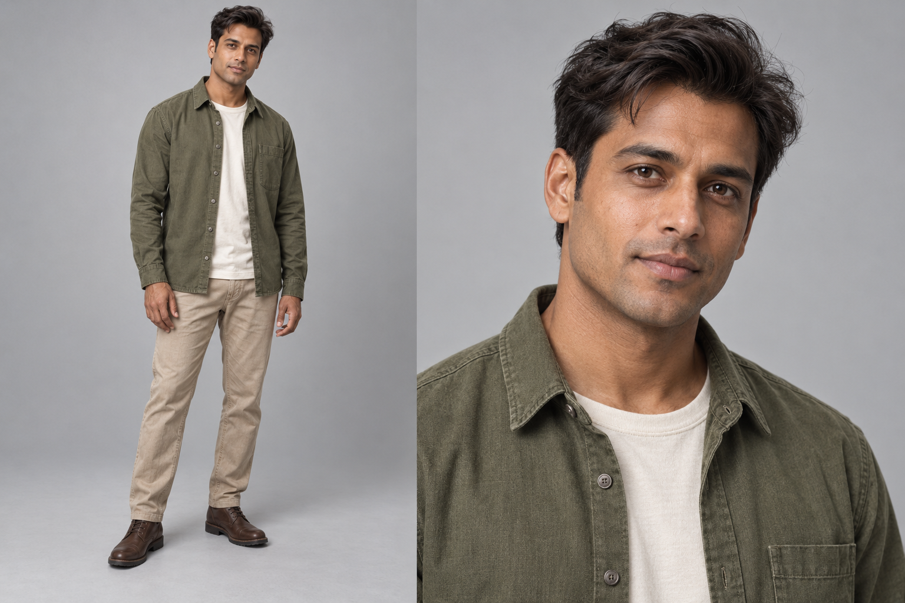

# Original short-groom and layered character target

**Retained artist-discussion reference.** One complete original body/portrait chooses short dark swept hair, a readable softly angular face, an open olive overshirt, ivory tee, sandstone trousers and brown boots. Both agents actually inspected the unchanged1536×1024 original; root independently verified the critic's complete handoff and its fine-stubble observation.

[Readable design brief](../../../research/MASCULINE-CHARACTER-TARGET-2026-10-04.md), [exact prompt](PROMPT.txt), [limited primary reference](REFERENCES.md), [independent result](RESULT.md), [root initial reading](ROOT-IMAGE.md), [root facial-finish check](ROOT-VARIATION.md), [verified result](ROOT-RESULT.json) and [receipt](RECEIPT.md).

This is an original synthetic artist target, with faint beard shadow differing from the clean-shaven prompt. It supplies no current runtime starter, editable head/garment source, hidden fit/coverage, motion or AAA acceptance. Current image variations and automatic construction stop. A distinct next source or roadmap goal requires fresh independent worth. Accepted/default/original/frozen assets and the full roadmap remain preserved.
