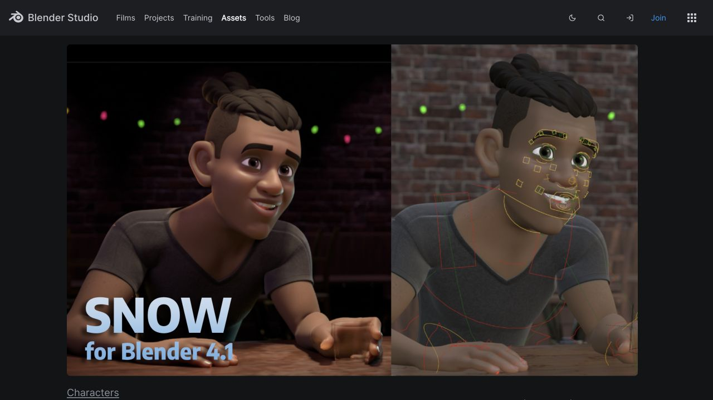

# Snow: a named stylized reference, not the chosen short groom

The current [official Snow v4 page](https://studio.blender.org/characters/snow/v4/) offers a106.4MB character archive, displays Blender4.1, and links CC-BY4.0 attribution. Its HTML download filename is `snow_v42.zip`; the archive and full licence text were not opened. The page credits Blender Studio and names Demeter Dzadik as publisher. The requested credit is “Snow Rig (CC) Blender Foundation | studio.blender.org”.

Root inspected this actual1280×720 original: a stylized bust with large eyes, a rolled front/crown mass, closely cropped sides and a visible bun. It is a concrete cohesive character reference. The bun differs from Sugata's retained short swept target; hidden geometry, materials, attachment, complete angles and moving appearance remain unknown.

The source boundary is Snow's original character, while Sugata's current g050 head is a separate source. A retain this precise named page/image/archive lead for a separately justified original-character study; it makes the next source choice concrete. B decline it as the intended short groom or a g050 attachment source; that preserves the current character brief and avoids an unsupported transfer. Root and the independent critic agree on both narrow conclusions after separately viewing the original. No avatar or hairstyle is promoted.

[Independent result](RESULT.md), [exact receipt](RECEIPT.md), [sole search](SEARCH.json), [sole live page response](PRIMARY.json), [readable page text](PRIMARY.md), [source HTML](PRIMARY.html), [root observations](ROOT-OBSERVATION.json) and [reference-tab events](native-events.json) retain the witnesses. The page describes bundled rig UI scripts; none was downloaded or executed. No other page, query refinement, archive, licence navigation, generation, geometry or adaptation followed. Only owned reference tab35 was closed; the Sugata review service remains available.
