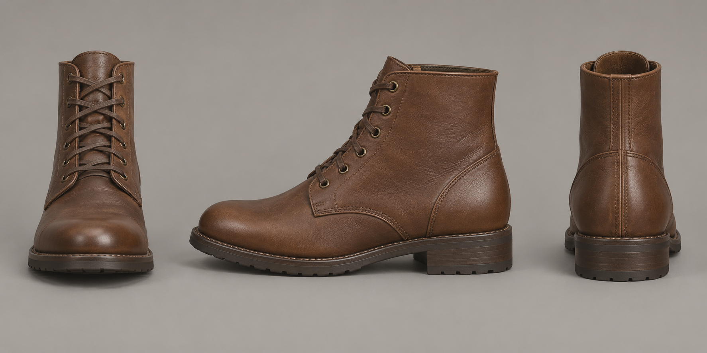

# Brown ankle boots: an original artist proposal

One independently reviewed original sheet makes a practical brown lace-up boot's front, profile and rear design vocabulary available for discussion. The rounded toe, distinct darker outsole and modest heel repeat across the three complete views. The rear stitched strip, counter arc and exposed shaft rim are newly authored design choices; the retained whole-character illustration does not supply a direct rear or unobscured shaft top.

Root and the independent critic separately inspected the entire unchanged original. Retain it as a qualitative artist target. Visible shaft rims and sole faces show illustrative perspective; the views are not calibrated projections. Exact dimensions, last, left/right pair, foot interfaces, complete editable surfaces, topology, UV/PBR, rig, fit and motion remain unowned. Finished footwear, runtime starter and AAA character quality remain open.

[Original character intention](../../../research/MASCULINE-CHARACTER-TARGET-2026-10-04.md), [exact prompt](PROMPT.txt), [plan](PLAN.json), [source criticism](SOURCE-RESULT.json), [root admission](ROOT-ADMISSION.json), [sole generation job](IMAGEGEN-JOB.json), [original-copy identity](IMAGEGEN-OUTPUT.json), [independent actual-image verdict](RESULT.json), [independent receipt](RESULT-RECEIPT.json), [root image reading](ROOT-IMAGE.json), [root close](ROOT-CLOSE.json).

Built-in image generation produced one 1774×887 PNG: 1842677 bytes, SHA256 `cdac6241119851e8398c01b05255a148c9da77bd77f470bd5574a50b63b19066`. The default original and project copy are byte-identical and preserved. No editing, regeneration or source import followed. Further raster retuning is closed; complete source/frame and foot-interface ownership are required before later footwear authorship. The checklist and broader roadmap are unchanged.
