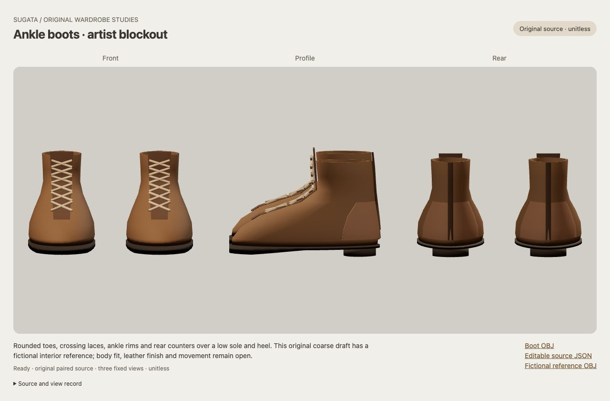

# Original paired ankle-boot artist blockout

This isolated source makes the brown lace-up boot design editable in 3D. The first unchanged front/profile/rear image shows rounded forefeet, ankle shafts, contrasting tongue/front facings and crossing laces, deliberate rear counters and centered strips, ankle rims, and a separate dark sole and low heel. It is a coarse artist starting point; visible faceting, steep instep transitions and raised decorative details remain.

[Editable source JSON](export/mesh.json), [boot OBJ](export/boots.obj), [separate fictional reference OBJ](export/nominal-reference.obj), [literal original producer](build.py), [fixed review page](index.html). The complete master contains 2,720 points, 5,288 triangles and 38 named parts across the mirrored pair. Two parts are fictional interior reference volumes, explicitly omitted from the rendered artwork; the boot OBJ contains the 36 visible artist parts. Both OBJ files retain the complete master point array and their respective named face groups.

The source owns outer and inner upper surfaces, rim and floor, tongue/front facings, crosslaces, rear counter panels and strips, sole and heel. Contact and decorative overlap intent is recorded in the JSON. The unitless frame and all dimensions are original artist choices. The closed nominal reference is a fictional envelope with an ankle continuation above the shaft, rather than an anatomical foot or physical shoemaking last. No `g050` geometry or joint-name subset was reused.

Root and critic independently retain this coarse artist source: all required visual roles pass in the actual first image. The [independent result](RESULT.md), [result receipt](RESULT-RECEIPT.json) and [root close](ROOT-CLOSE.json) preserve that scope and its limits. The [source review](SOURCE-RESULT.md) preceded the sole builder/checker trial; both exited 0 and were reaped. [CPU result](CPU-RESULT.json) and [root's independent saved-graph check](ROOT-CPU.json) support closed, oriented manifold topology, positive volume and Euler 2 per part, exact mirrored coordinates/winding and both OBJ roundtrips. Numerical checks do not qualify appearance, general self-intersection, inter-part contact or continuous cavity/enclosure.

The [actual native record](NATIVE.json) and [DOM record](NATIVE-DOM.json) bind the image to the exact CPU-qualified mesh, three fixed camera draws and 36 rendered parts. The default viewport was retained without an override. Only the owned review tab was closed afterward; this is not a measured GPU-retirement result. No second render, image retake, geometry, material or camera tuning occurred.

The [unchanged design sheet](../ankle-boot-design-proposal/README.md) supplies qualitative exterior language. Fine leather, stitching, eyelets and tread remain unfinished. Physical source/frame correspondence, anatomical fit, body ranges, rig, morphs, poses, motion, finished outfits and AAA character quality remain open. Accepted/default assets, original references and the wider roadmap are preserved.
