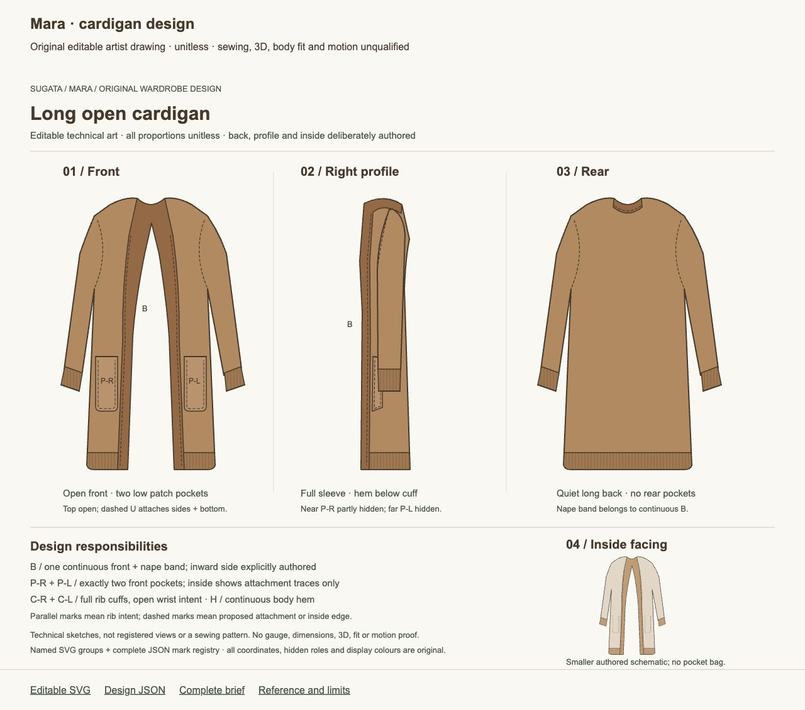

# Mara's long cardigan: editable technical design

The original front, right-profile, rear and smaller inside-facing drawings are available as an editable artist handoff. The first whole sheet passed independent and root visual review. It develops Mara's caramel open layer into explicit band, pocket, cuff, hem and inside roles.

Open the [editable SVG](../mara-cardigan-technical-design/cardigan.svg), [complete design JSON](../mara-cardigan-technical-design/design.json), [brief](../mara-cardigan-technical-design/BRIEF.md) or [local review page](../mara-cardigan-technical-design/review.html). Import a working copy of the frozen SVG to edit its named groups. SVG is authoritative; JSON contains the exact complete 94-element tree and feature map at this checkpoint. Refresh that association after editing; there is no automatic generator.

The front has two open-top patch pockets with proposed attachment along their sides and bottom. The right-profile near pocket is partly obscured by the sleeve; the far pocket is hidden. The rear has no pockets. A continuous front/nape band, full cuffs and lower rib hem are deliberately authored; parallel lines indicate rib intent, with no specified gauge. The smaller inside schematic shows band and attachment traces, without a pocket bag. Its fine strokes are delicate at the reviewed scale.

All proportions are unitless. Profile, rear and inside are new artist choices. This is a technical drawing, with sewing, registered projections, fabric behaviour, 3D, body fit, morphs, motion and runtime integration still open. [Reference boundaries](../mara-cardigan-technical-design/REFERENCES.md) distinguish Mara's visible direction and the maker's woven-robe marking example from these original choices.

The [independent image review](IMAGE-RESULT.md), [exact receipt](IMAGE-RECEIPT-CRITIC.json) and [root decision](ROOT-IMAGE-CLOSE.json) retain the qualification. This fixed drawing and capture are closed to further tuning. Future wearable construction needs a complete coupled body/garment contract and new evidence.
