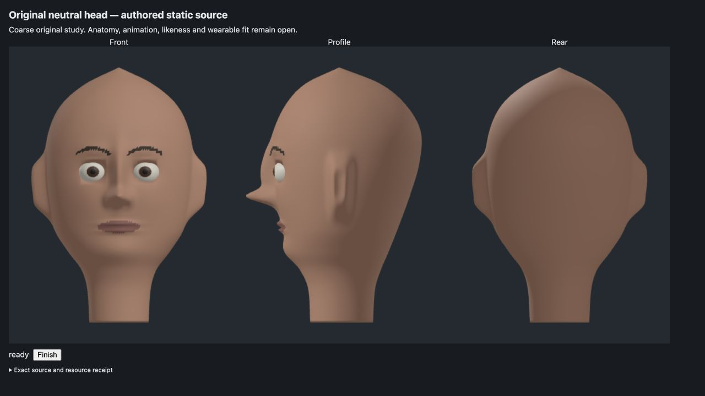

# Original neutral head — refused visual study

The complete selected appearance target is **B**. The first and only rendered study has exposed button-like eyes, a pointed crown and visibly stepped brow/lip borders. Root and the independent critic inspected the same whole original separately and agree. Numerical source/export checks and recorded native identity remain scoped **A**; they do not qualify appearance.

The isolated [JSON source](output/mesh.json), [OBJ](output/neutral-head.obj) and [MTL](output/neutral-head.mtl) are retained for inspection. They contain 25,014 vertices and 50,016 triangles, one closed skin component and two closed eye components. This is a negative original construction study, with no runtime/default or roadmap promotion. Anatomy, likeness, skin-eye containment, rigging, expressions, wearable fit and moving-avatar quality remain open.

[Root reconciliation](ROOT-RECONCILIATION.md), [independent image verdict](IMAGE-RESULT.md), [exact receipt](RECEIPT.md) and [frozen manifest](MANIFEST.json) preserve the decision, actual inputs, jobs, outputs and limits. The height/azimuth/profile/Gaussian/oval-cup construction and all fixed-source parameter, material, tessellation, camera and capture rescue attempts are closed. A future complete authored facial master source needs a fresh worth decision before any construction; neither this study nor another target sheet supplies that ownership.
