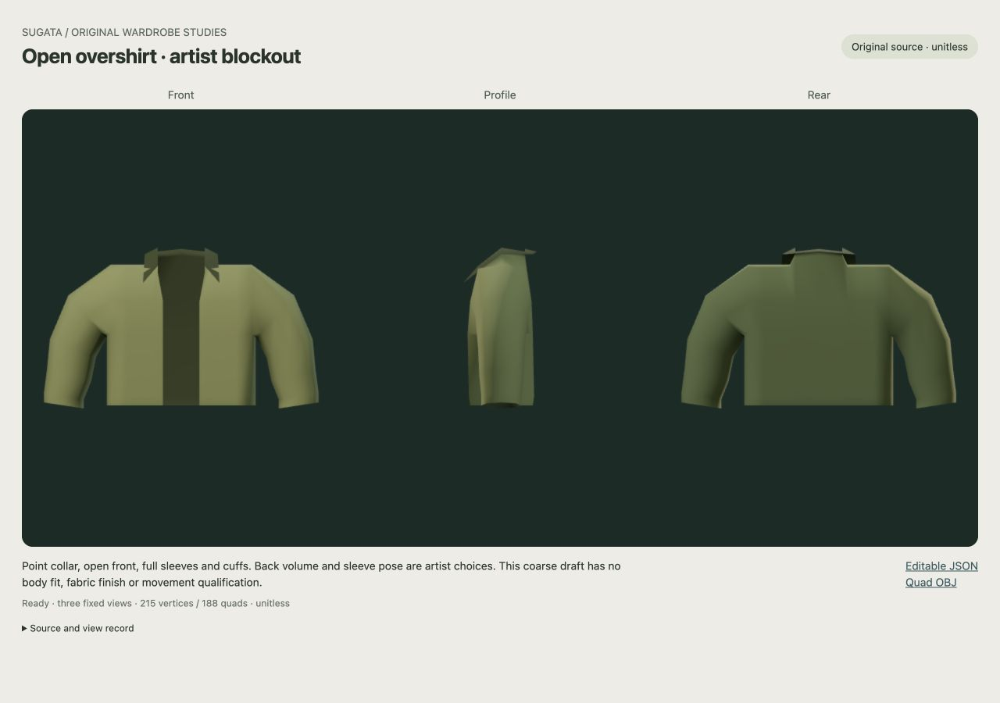

# Original open overshirt artist source

An editable unitless blockout with an open front, attached collar, full hanging sleeves and rear volume. Root and an independent critic reviewed the complete original three-view image and retain this as an **artist starting point**. Angular shoulders, small collar leaves, plain profile and weak visible cuff-band separation remain. Finished target conformity, cloth, material finish, body fit and movement are outstanding.

[Editable mesh JSON](export/mesh.json) · [Quad OBJ](export/overshirt.obj) · [Original numeric authoring source](build.py) · [Fixed viewer](index.html)

X is lateral, Y upright and +Z front. All numbers, back depth and sleeve pose are original artist choices. Shared indices join front/back, side/shoulder, eight-point sleeve roots and the seven-point neck stand/leaf. The independent raw-graph/OBJ check passes 215 vertices, 188 quads, one connected orientable surface and three actual boundaries: continuous collar/front/hem plus two wrist openings. This supports topology, not general self-intersection, physical cloth, body/pose clearance or a wearable garment.

To inspect or reuse the work, open the JSON/OBJ directly. Preserve this frozen study; make a fresh working copy for further authorship. The original builder refuses an existing export directory. [The retained character target](../../../research/MASCULINE-CHARACTER-TARGET-2026-10-04.md) and its folded-shirt reference inform visible style only; they supply no hidden dimensions or fit authority.

The first viewer source was withheld before export because a checksum continuation could allocate after closure. Its [original refusal](../overshirt-artist-source/SOURCE-RESULT.md) remains intact. A separately reviewed single lifetime guard precedes this sole export/check and one fixed original capture. Both CPU jobs exited zero and were reaped. Root captured only tab41 at 1280×900, reset the temporary viewport and closed41; no measured GPU retirement follows from closure alone. No geometry/material/camera correction or retake occurred.

[Independent image result](RESULT.md) · [Exact critic receipt](RESULT-RECEIPT.json) · [CPU result](CPU-RESULT.json) · [Actual native record](NATIVE.json) · [Root image observation](ROOT-OBSERVATION.json)

The fixed method is closed to further tuning/recapture. All broad AAA character, wardrobe, fit, expression, performance and representation goals remain open. Accepted runtime assets and defaults are unchanged.
