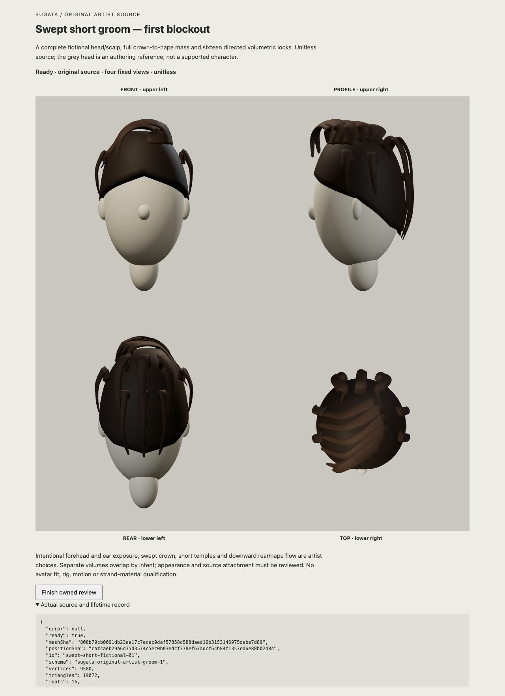

# Original short-groom study — rejected appearance

The complete editable source passes its saved geometry/export checks. Its first rendered image fails the appearance gate: the broad mass reads as a helmet, with visibly separated crown and ear-side loops. This source stays isolated and is **not an accepted hairstyle or Sugata asset**.

The [original JSON](export/mesh.json) and [grouped OBJ](export/groom.obj) retain the fictional unitless head/scalp, full mass and sixteen authored locks. Root and the independent critic traverse the complete saved data: 9,580 positions, 19,072 triangles, 22 named closed parts, 16 root records and 724 scalp faces. Those results establish finite source/export properties, not visible continuity, physical attachment, continuous clearance or an embedded solid. [Root data receipt](ROOT-DATA-RECEIPT.json) records the independently corrected observer naming mistakes without changing the candidate.

The sole native trial uses the unchanged source and four fixed cameras at the actual default 1280 × 720 viewport. The [identity/framing gate](ROOT-NATIVE-GATE.json) verifies actual DOM-reported source/buffer hashes and all four matrices before the whole original image. Finish is invoked once; all 27 owned disposal calls return without reported errors, and only the owned tab is closed. GPU retirement is unobserved. See [root image and cleanup receipt](ROOT-IMAGE.json).

The bounded research question was whether a complete original mass plus separately authored rooted volumes could supply coherent short swept flow across all four views. **Decision: this construction does not.** The official [Blender curves introduction](https://docs.blender.org/manual/en/latest/sculpt_paint/curves_sculpting/introduction.html) helped distinguish surface attachment, roots and control points; it supplied no missing hairstyle geometry or visual qualification. The exact single live response is retained in [REFERENCE.json](REFERENCE.json).

This fixed source, mass, roots, lock sections, material, camera, viewport and capture remain closed to rescue or tuning. A future hairstyle experiment would need a separately nominated complete authoring contract that owns visible root-to-mass and crown-to-nape continuity before construction. It is not admitted by this closeout.

No anatomy, supported-character identity, avatar fit, rig, skinning, morphs, finished strand material, motion, runtime or AAA acceptance follows. The existing accepted assets and full character/expression/wardrobe/representation roadmap remain intact. Final critic review and root closeout are recorded separately; this document adds no project checklist completion.
