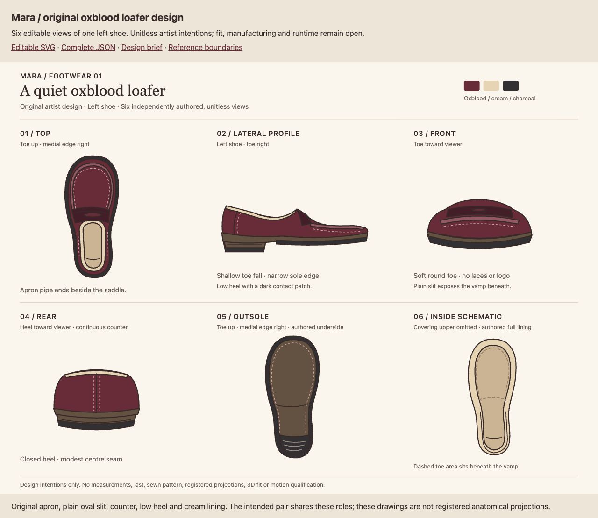

# Mara's oxblood loafers: editable technical design

The original six-view **left-loafer** sheet is available as an editable artist handoff. The first whole rendered sheet passed independent and root review. It develops Mara's low oxblood slip-ons into explicit apron, saddle, entry, counter, heel, outsole and lining choices.

Open the [editable SVG](../mara-loafer-technical-design/loafer.svg), [complete design JSON](../mara-loafer-technical-design/design.json), [brief](../mara-loafer-technical-design/BRIEF.md) or [local review page](../mara-loafer-technical-design/review.html). Import a working copy of the frozen SVG to edit its named groups. SVG is authoritative; JSON retains exact source XML and all 100 elements, attributes, text/tail, parent/child order and view/feature associations at this checkpoint. Refresh that association after editing; it does not regenerate a drawing.

Top, lateral profile, front, rear, outsole and inside schematic are independently authored, unitless views. The intended pair shares these design roles; the right partner's anatomical shape and fit require later authorship. The rounded apron pipe ends beside an unbranded saddle. Its plain oval slit is subtle at the reviewed scale and expresses graphic intent. The cream entry, closed counter, low heel and dark heel patch remain readable. The inside schematic omits the covering upper to expose lining and footbed; dashed toe marks indicate the region beneath the vamp.

The [maker study](../mara-loafer-primary-study/README.md) supports qualitative visible language only. The cream lining, plain slit, rear and sole are original choices. Registered projections, measurements, foot/last anatomy, sewing, material behaviour, 3D surfaces/cavity, wearable fit, morphs, motion and runtime remain open.

The [independent image/data review](IMAGE-RESULT.md), [exact receipt](IMAGE-CRITIC-RECEIPT.json) and [root decision](ROOT-IMAGE-CLOSE.json) retain the qualification. This fixed drawing and capture are closed to further tuning. Future wearable construction needs a complete coupled footwear/body contract and new evidence.
