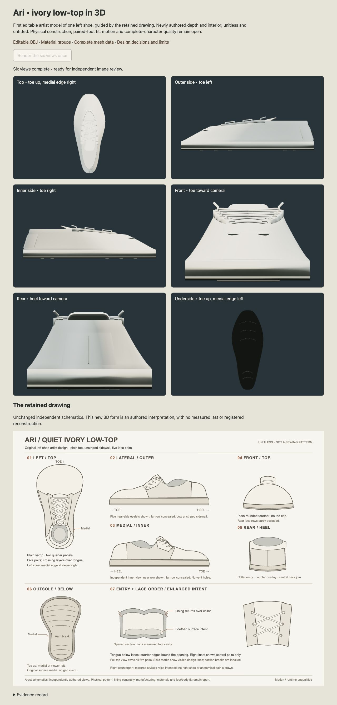

# Ari first 3D low-top — closed, appearance refused

**The first editable mesh is not an accepted artist delivery.** Root and the independent critic inspect the complete actual six-view packet and agree on B. Keep the accepted [2D shoe drawing](../ari-sneaker-artist/ARTIST-HANDOFF.md) as Ari's usable shoe target.

The new source owns a unitless left-shoe frame, twenty-five closed components, a real entry/lining/footbed, separate tongue, ten perforated guides, one continuous lace, counter/seam and original underside marks. JSON/OBJ/MTL retain those editable parts. The one actual build and independent full-data audits pass within that finite scope. They establish neither shape quality nor physical threading, manufacturing, a measured last, an anatomical pair, wearable fit or motion.

The actual views resolve the research question: **this particular closed loft/component construction does not communicate the retained rounded low-top well enough.** Profiles are planar wedges and front/rear broad trapezoids; two unexplained dark crescents interrupt the plain vamp; underside marks are too faint. These are visual findings, not a proved mesh-hole/intersection/shader diagnosis. Useful entry and lacing cues do not qualify the complete brief. [Independent full-image review](IMAGE-REVIEW.md) records actual native-frame witnesses and two alternatives per finding; [root final decision](ROOT-IMAGE.json) independently verifies them. No image, camera, material, topology, shape, numerical or source rescue/retake follows this refusal.

## Exact progression and collection

- Worth A07e66d/869a95 and root3dabf3/5c3b09 admit inert preparation12:58:55.357882UTC, with absolute14:13:55.357882UTC stop through closure.
- Complete source A897069/eb60da, root64e4ba,34-pin CPU-ADMISSIONf23b8c/SHA978f52a76c3f41c94de24dc04f17793407a9ac6ee81f6b84e106f44cf86cfcb8 precede the sole actual Node entryfdf92d/exit0/no session/PID4919,13:21:38.344–.364UTC. [Exact command/tool return](TOOL-CPU.json), [actual result](CPU-RESULT.json).
- Actual25parts/4190vertices/8364triangles.20.458667ms is checked post-import elapsed;76234752B RSS is a sample, not peak/hardcap/nativeCPU/performance. Root actual-datae6d157 and stable criticda7523/7b97c9 pass; rootwholepairbadb30/6a3767+db0fbb/53rows42paths756b4c independently verifies. [CPU review](CPU-REVIEW.md), [receipt](CPU-RECEIPT.json), [root](ROOT-CPU.json).
- Root exact-serving c231b2/c33aa6/e77818 and51-pinGPUadmission756b4c/SHA433f7e65a93c6b1570b3978f15bfbf75b0306ff9c50f41b17ab019eb8e9e5f15 precede freshlaunch4bd063. One explicit button click in IAB3tab8 renders six570×340/DPR1 views13:35:31.763–.908UTC.29calls/8364triangles each;145.3ms checked elapsed is not performance qualification. [Browser record](BROWSER-RESULT.json).
- The six PNGs total299321B. One unchanged1280×2670 wholeJPEG235416B gives534737B total; natural1280×720/DPR2 browser viewport, no override/crop/resample. [Image identities](IMAGE-COPY.json), [root collection](ROOT-RENDER.json). Root b3ba6d verifies51pins/PNGIHDR+CRCs/counts/identity and records whole-image opinion before critic pixel opinion. Later root separately inspects existing front/underside PNGs; no new capture.
- Stable blind independent image B05d80f/02da5a, IMAGE-REVIEW4595/SHA70fa04297af91648f7b8bb2f286c45228c58bc95725ff65d690612c01c4a6625, receipt22421/SHA162885fc8f66d72d5b2d21e900ad1ca71e6a2d787f6425fdad4eef6ea1ae2c16. Root whole-pairad9f6a and fresh76rows/63paths finalgate accept refusal. No pending critic edits.

Root's false64-versus65 capped-level expectation and critic's annotated-manifest receipt-reader errors are preserved with witnesses/corrections/alternatives. They were observer/receipt errors corrected against immutable output bytes, with no builder replay or source/data change. Text-reader output clipping was recovered explicitly before acceptance; no whole-read claim relies on clipped material.

All34 known geometry/material/renderer owners report successful disposal; fetch abort and context-loss are requested. Those API observations do not prove private partial-constructor or physical-driver retirement. Tab8 is closed and the sole CPU result is fully collected. No owned target job remains. Vite870 and the existing ACTIVE ten-minute recovery timer remain; human steering wins.

## Preserved boundary and next action

No new online retrieval was needed: accepted original2D source/current same-run primary-reference boundaries and exact installed primary APIs informed this isolated first3D question. Existing design references remain unchanged. No commercial asset, old boot/Mara source, body/foot/last, native renderer, held constructor or field collector was imported. No accepted/default/runtime/board/checklist/roadmap source changed. The22scoped checks and10broad goals remain.

Preserve the rejected source, exports and images. The consumed analytic mesh method is closed without a successor. Only a genuinely distinct roadmap ownership question, with fresh independent worth, may start after this closure; no new experiment is admitted by this README. Future full-body/foot/last, physical material/fit/motion, expressions and representation and complete-character/AAA goals remain open.
