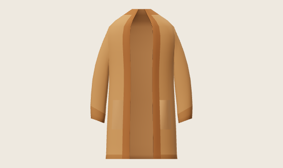

# Mara — editable cardigan blockout

This standalone, unitless 3D artist model has passed independent saved-data and actual six-view appearance review as a **stylized blockout**. It translates the retained long-cardigan design into new depth; it is not a worn garment or a reconstruction of registered drawing views. Documentary delivery approval is recorded separately in `DELIVERY-REVIEW.md` and `ROOT-DELIVERY.json`; writing this handoff alone grants no additional qualification.

Open the [authoritative editable mesh JSON](out/model.json), or use the [OBJ](out/model.obj) with its adjacent [MTL](out/model.mtl). The OBJ and MTL association and every exported vertex/triangle were checked against the JSON. Import into an artist's editor has not been exercised. The OBJ supplies positions, triangles and material roles, without UVs, authored normals, sewing data or rigging.

The model contains 2,288 vertices and 4,572 triangles across three editable material shells: one connected body-and-sleeves shell and two contacting patch shells. The patches are separate components; their intended side/bottom contacts do not establish a welded or sewn union. The five authored colour roles are body, front/nape band, cuff/hem rib intent, patches and inward faces. They are display colours, not a calibrated knit material.

Coordinates are invented art units: +Y up, +Z front, +X page-right in the front view. Hem Y=0 and neck Y=102 are authoring landmarks, not physical measurements. Component names `patch_posX` and `patch_negX` use this frame. The side view is from +X; it makes no anatomical-side claim.

The unchanged first packet shows the [front](front.png), [side from +X](side.png), [rear](rear.png), [high front oblique](high-front.png), [low front oblique](low-front.png) and [rear oblique](rear-oblique.png). Each is 570×340. The [whole captured page](first.jpg) retains all six views and the public execution record. Compare them with the unchanged [original technical drawing](../../appearance-2026-10-05/mara-cardigan-first-native/original-first.jpg).

Together, those views support the long open silhouette, attached hanging sleeves, open cuffs, continuous band, inner faces, quiet back and two low open-top patch intentions. The pocket mouths are subtle at the delivered scale. The straight body, coarse faceting and angular neckline remain visible blockout limits. No detailed functional pocket cavity, soft drape or finished knit appearance is claimed.

Body registration, global self-intersection, collision-free fit, coverage across bodies/morphs/poses, sewing, physical dimensions, fabric behaviour, layering, rigging, animation, avatar runtime, performance and AAA character quality remain open. This model adds no native Mara character, fitted outfit or accepted runtime/default asset.

The [full geometry brief](../mara-cardigan-first-volume/BRIEF.md), [metadata-only correction contract](CONTRACT.md), [independent CPU review](CPU-REVIEW.md), [independent image review](IMAGE-REVIEW.md) and [root image verification](ROOT-IMAGE.json) preserve the decisions and limits. This candidate has consumed its sole CPU build and GPU packet; do not rebuild, reload, render, retake or revise it under the closed experiment. Any future wearable work needs a separate complete coupled body/garment contract.
