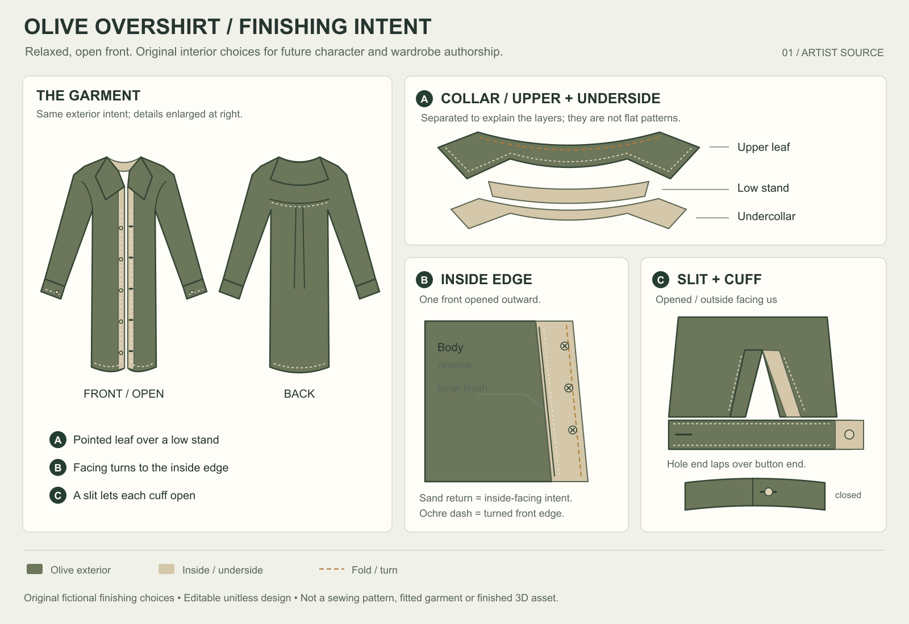

# Olive overshirt — editable finishing intent

[View the full sheet](finish.png) · [Edit the original vector](finish.svg)

The complete front and back locate three original artist decisions: a pointed upper collar over a low stand and separate undercollar, an interior-facing return with its turned front edge, and a sleeve slit with overlapping cuff/button closure. These hidden details are authored choices for the fictional character, not recovered garment measurements. Sand identifies inside/underside intent.

The inside-panel Body/reverse and Inner finish annotations have subdued contrast. The sand strip, edge marks and clear captions below explain the relationship. Use this sheet for artist discussion with that limitation. It is a unitless design, not a sewing pattern, fitted garment, native3D source, physical construction proof or AAA character qualification.

The sole CPU preview uses the literal10031-byte SVG, not a browser or native3D capture. It finished naturally with exit0 in reported889ms, observed214656KiB maxRSS, no warnings. Exact PNG231333bytes,1600x1100RGBA8,SHA256`a4249823eafa85770bb6645a804c63cfd7766381f42999e6e299faad3b35e556`; all PNG chunk checks and source association pass. These are scoped observations, not hard memory/termination guarantees or a performance benchmark. [Exact job](JOB.json) · [Complete source contract](DESIGN.md) · [Official API references and exact retrieval](REFERENCES.json).

Independent [source review](SOURCE.md) and [actual-image review](IMAGE.md) were sealed before root opinions were read. Root wholly read both stable handoffs and verified actual witnesses. Root initially refused the faint interior label as blocking; the critic independently accepted it with a caveat. After inspecting the unchanged whole image and the explicit legend again, root revised the qualification consequence to artist A with the same caveat. Both initial opinions remain exact; no image/source repair occurred. [Final root judgment and complete evidence](ROOT-IMAGE.json) · [Original root image opinion](ROOT-IMAGE-FIRST.json).

This is an isolated artist supplement. Existing accepted/default/original/frozen assets, the closed overshirt blockout, checklist23scoped/10broad, Ari constructor HOLD and the full character/expression/wardrobe/representation/coupled-fit/motion/performance/VTuber/Mii roadmap remain unchanged. The first preview is consumed: no more graphical edits, colour/font/layout repairs, retakes, alternate renderers, crops or successor finish sheets under this nomination. Next substantive work needs a distinct bounded question and fresh critic worth decision.
