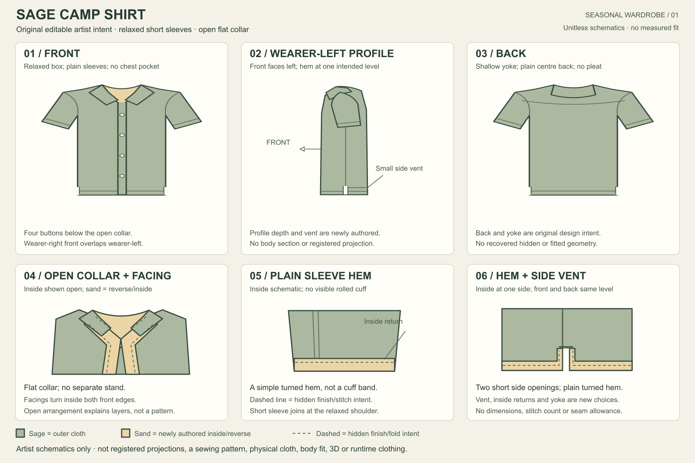

# Sage camp shirt — editable artist design

[View the full sheet](shirt.png) · [Copy the editable SVG](shirt.svg) · [Compare the retained seasonal outfit](../../appearance-2026-10-19/warm-weather-outfit/first.png)

The new source gives a garment artist six original schematics: front, wearer-left profile, back, open collar/inside facing, plain sleeve hem return, and lower hem/side vent. The relaxed sage body, short sleeves and flat open collar follow the retained outfit's exterior language. Back/yoke, facing, inside returns and small side vents are explicitly new design choices. No accepted illustration or runtime garment was changed.

Every shape, label and colour is a literal editable SVG element. The six named `data-view` groups and feature IDs locate the contours and details; [the edit guide](DESIGN.md) explains their ownership. Duplicate the retained source before later authorship. Views are separately drawn unitless schematics, with no automatic synchronization or registered projection. Sage means outer cloth, sand inside/reverse, dashed lines hidden finish/fold intent.

The front caption specifies wearer-right-over-left overlap. Its centre strip and four buttons communicate that decision; they do not demonstrate a matched flap/underlap, buttonhole or verified assembly. The sheet is not a sewing pattern, physical cloth, body fit, 3D/rig/motion or runtime source, a complete starter character, or AAA qualification.

Independent and root reviewers each inspected the actual whole first1800x1200 image and retained it unchanged for this narrow artist use. All six areas, finishing relationships, captions and limits are readable. The [image review](IMAGE-REVIEW.md) and [root verification](ROOT-IMAGE.json) preserve the exact evidence and overlap caveat. The first preview is consumed: no retake, crop, font/colour/shape/renderer repair or further graphical refinement under this nomination.

[Receipt, exact inputs/command/job/hashes and limits](README.md). All ten broad project outcomes and the full character/expression/wardrobe/representation/coupled-fit/motion/performance/VTuber/Mii roadmap remain open.
