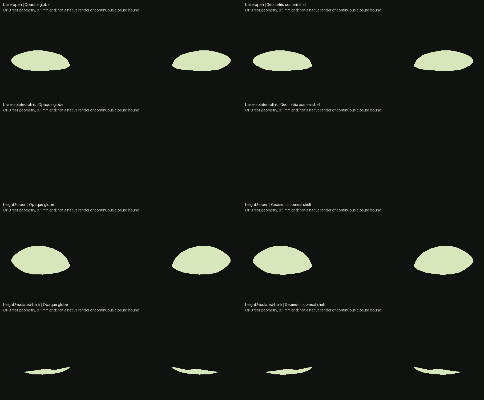

# Identity-aware eyelid aperture: sampled CPU evidence

**Current result:** the calibrated extension reproduces a useful red/green case for
future identity work. At the native isolated blink coefficient **0.752**, the unchanged
body has zero exposed eye samples on the prescribed grid. Applying only
`eyes/eye-height2-decr-incr: +1` to the body leaves **23.23 mm² of sampled opaque globe
and 23.97 mm² of sampled corneal shell per side**, with a maximum occupied-column span
of **2.1 mm**. The eye proxies remain unfitted. This is a limitation of that specific
CPU construction, not a demonstrated defect in a fitted native avatar or an approved
corrective.

The [calibrated protocol](NEXT-PROTOCOL.md) was declared before that run. Its union
globe/cornea grid is 908 × 319 at 0.1 mm pitch. A separate 3D ray/AABB implementation
matches all 16 masks byte-for-byte, and six analytic front-cover, rear-wall, window and
winding controls pass both kernels. The [independent critique](CALIBRATED-CRITIQUE.md)
records all source and report hashes, shared inputs and limits. Asset-sided and
both-windings results agree; the open identity's eleven-sample side asymmetry is retained.
No native motion stack, skinning, proxy fitting, shading or continuous gap bound has
been qualified. Blink calibration, product controls and accepted assets are unchanged.

The lossless [packet receipt](cpu-packet-v1/receipt.json) binds all 52 original files
from both CPU instruments and both independent oracles, including reports, binary masks,
executed controller copies and numeric plots. Its SHA256 is
`9cadb38e3d2e5cdaa3d48797f564092b1e638420f109a169d84e9b2422255fa9`.
`package.py` verifies decompression against every original byte; raw evidence remains
under `captures/identity-closure-2026-09-26/`.

## Initial pilot and the calibration correction

This is a CPU instrument study for PUNCHLIST 10.3, not an identity feature, corrective,
rendered appearance pass or new asset. The three failed instruments in
`docs/research/identity-sculpting.md` §7 were read first. This pilot intersects actual skin
and opaque-globe triangles; it does not infer occlusion from nearest vertices, a spherical
shell or the average displacement of strongly/weakly driven morph vertices.

**Existing instrument found after the first pilot:** `ocular.selftest.mjs:1378` already
implements frontal triangle-depth lid-seal measurement for the unmodified asset. It includes
both cornea and globe, whereas this initial pilot includes only the opaque globe.
`Blink.js:267` also sets actual full-closure morph weight to **0.752**, not 1. A weight of
1 overshoots the useful native range. Therefore the initial pilot is neither a contradiction
of the runtime's blink calibration nor a new baseline measurement method. The useful next
scope is an identity-aware extension and independent cross-check of the existing instrument.

`aperture-pilot.mjs` reads the unchanged g050 GLB, sparse native blink morphs and current
identity data. It asserts matching identity mesh/ancestor transforms for body and globe.
For each finite orthographic ray from +Z, projected triangle barycentrics find the nearest
front-facing surface, respecting the actual materials' sidedness. The opaque globe is
visible only when it lies strictly in front of the nearest skin intersection. Cornea,
lashes, brows, materials, shading and refraction are outside this geometric instrument.

The initial 900 × 310 grid has 0.1 mm pitch. Each side contains 68,200 rays that intersect
the fixed opaque globe. Results below are sampled areas and column spans, not continuous
gap bounds. Identity is applied to the body alone; fitted eye proxies are unchanged, and
there is no runtime skeleton pose, normal correction or expression corrective.

| Configuration | Visible globe area per side | Maximum sampled column span |
| --- | ---: | ---: |
| Base, blink 0 | 131.48 mm² | 7.8 mm |
| Base, blink 0.5 | 26.84 mm² | 2.0 mm |
| Base, blink 1 | 0 sampled mm² | 0 sampled mm |
| Eye height2 +1, blink 1 | 0 sampled mm² | 0 sampled mm |

The named historical red case has **not** been established by this pilot. The current
comparison uses the uncalibrated coefficient 1 and excludes cornea, so it cannot settle the
native blink question. Do not force a failing fixture. A change
in a mean vertex-displacement statistic does not by itself prove a visible remaining gap.
Conversely, no visible globe samples cannot prove a healthy lid seal: folded or overlapping
lids, narrow unsampled gaps and other viewpoints remain possible.

Exact initial report:
`captures/identity-closure-2026-09-26/cpu-pilot-v1/report.json`, SHA256
`e62f64e1082fcfc8eccc7171adc632f358f3b23729c7f5f22b74aa16a921ab58`.
It binds all inputs and records mask hashes. Original binary masks, SVG plots and controller
are retained there. Root also inspected a labelled composite plotted directly from those
numeric masks; it is explicitly a CPU plot, not an avatar screenshot.

The independent source/oracle gate and synthetic controls are now complete for the
calibrated extension above. The next gate is actual native skin/globe visibility under
an explicitly separate instrument protocol. Do not select a corrective,
alter a range, claim a continuous <0.2 mm closure bound, change PUNCHLIST status or promote
an identity based on this preliminary result. No browser/GPU job or product/asset change
has been made for this study.
