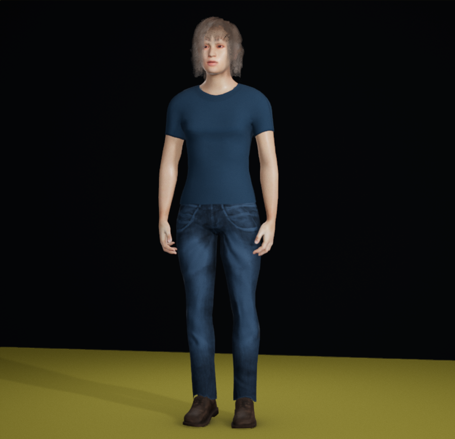

# Ink and denim: reviewed optional clothing composition

The fixed navy tee/denim, Brown hair setting without tint and warm shoes remain readable in the six declared originals. Both reviewers retain this optional current g050 recipe with a limited viewing guide. This is a clothing composition, not character/fit/movement/AAA qualification. Existing groom cards/stipple, jagged neckline edges and weaker Kitchen shadow-side hair separation remain visible.

Open [the guide](../../../../looks/INK-DENIM.md) and [the exact settings file](../../../../looks/ink-denim.json). The actual downloaded/reopened JSON is retained unchanged, as are all six images in [the native archive](archive/capture/report.json).

| Original context | Image |
| --- | --- |
| Neutral Studio portrait | [Original](archive/capture/neutral-portrait.png) |
| Kitchen complete look | [Original](archive/capture/kitchen-body.png) |
| Kitchen portrait | [Original](archive/capture/kitchen-portrait.png) |
| Existing small smile held at1.2s | [Original](archive/capture/smile-held.png) |
|0.5s after manualRelease | [Original](archive/capture/smile-released.png) |

The finite question was whether this near-matching top/denim palette retained its neckline, waist junction, trouser/boot silhouette and exposed face in two rooms and one existing smile/release context. The answer is yes for these originals. Kitchen is a distinct room/light recipe; Neutral is not calibrated colour. The Brown setting appears ashier in Neutral. The smile is subtle and two stills do not establish naturalness, intent or restoration of the original head pose.

[Root visual witnesses](ROOT-VISUAL.md), [independent critic witnesses/alternatives](CRITIC-POSTFLIGHT.md), [root retained-byte audit](ROOT-READBACK.json), [independent critic state/arithmetic audit](critic-state-readback.json) and [root final reconciliation](ROOT-HANDOFF.json) keep appearance decisions separate from supporting numbers. [Receipt](RECEIPT.md) and [checkpoint](CHECKPOINT.md) provide recovery.

The current primary [UNIQLO black jacket/corduroy reference](https://www.uniqlo.com/us/en/stylingbook/officialstyling/70000561) informed the dark-column/face emphasis question only. Its pale neckline and different garments are not reproduced; the [actually inspected screenshot](../ink-denim-value/uniqlo-70000561.jpg) and [worth decision](../ink-denim-value/CRITIC-VALUE.md) retain that limit. Failed/redirected initial reference URLs supplied no design content and were excluded.
