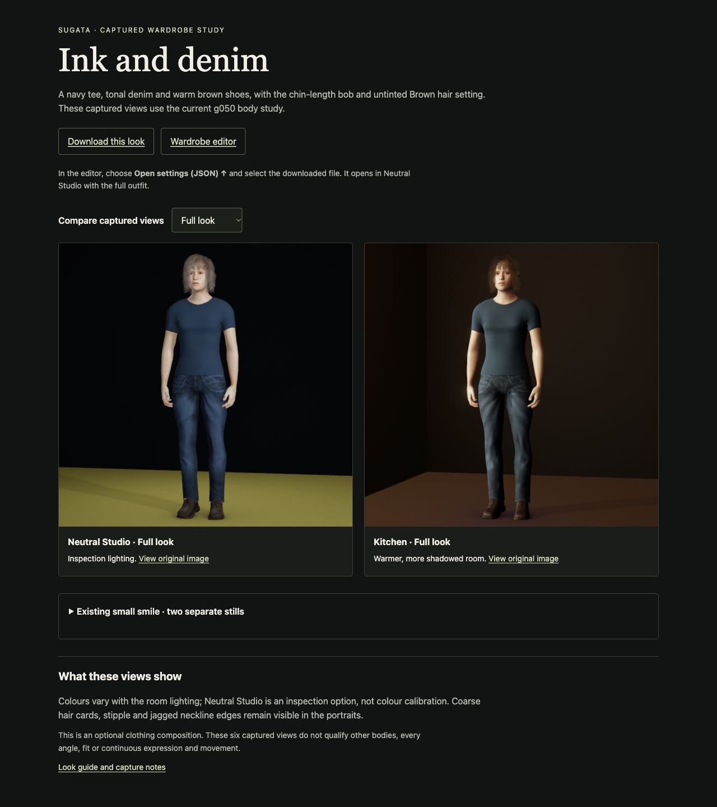

# Ink and denim comparison page

[Open the comparison page](../../../../looks/ink-denim-review.html) with the review server running. It pairs the already accepted room/portrait captures, keeps the two Neutral expression stills separate, and offers the exact settings download and unchanged originals. A single new guide link makes it discoverable.

Root and independent critic inspected all five actual desktop/phone page captures. The static page is accepted for these contexts; character finish, fit, continuous movement and representation remain open. Hair cards, stipple and jagged neckline are still visible. No avatar or asset was changed.

[Contract](PLAN.md), [source critique](CRITIC-SOURCE.md), [actual UI receipt](UI.json), [actual root commands](CUA-COMMANDS.md), [root visual decision](ROOT-VISUAL.md), [independent actual presentation review](CRITIC-UI.md), [root full handoff readback](ROOT-HANDOFF.json), [adoption](ADOPTION.json), [complete receipt](RECEIPT.md), [recovery](CHECKPOINT.md).

