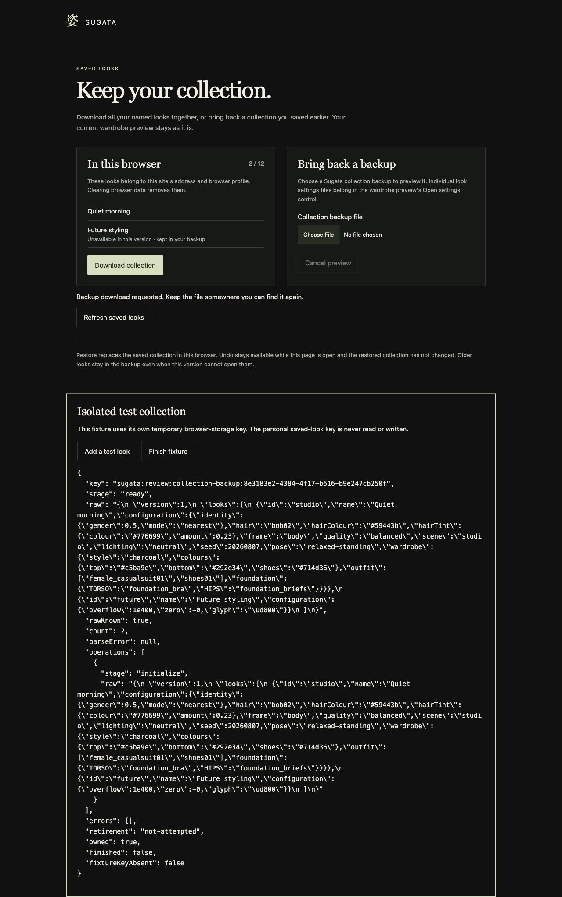
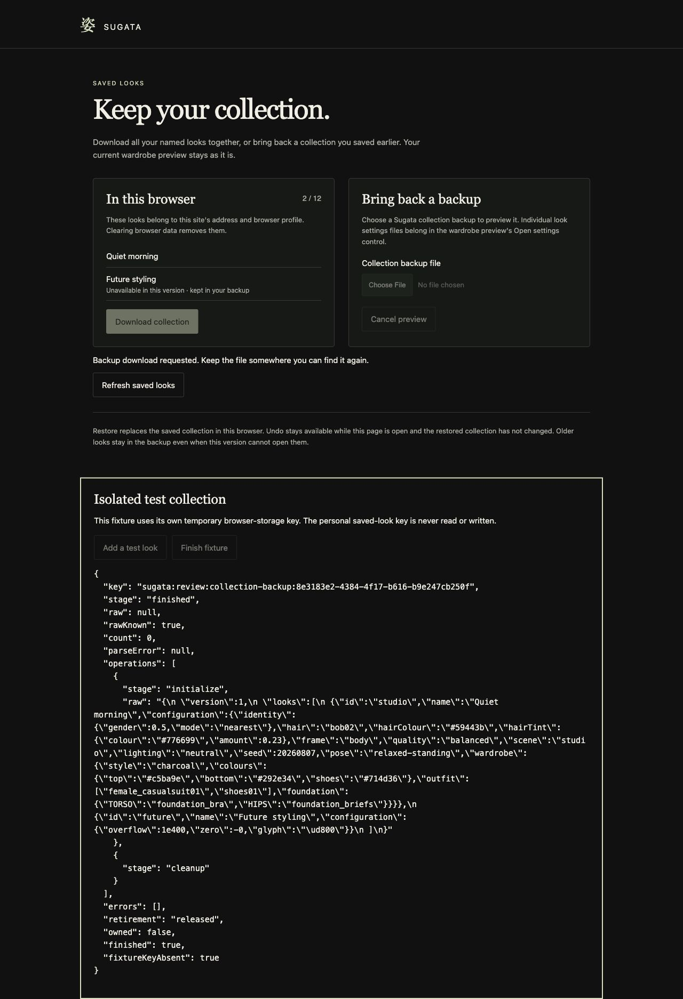

# Collection backup: first native trial stopped

B for complete feature delivery. The first public completed-download wait timed out after15seconds. The page visibly says the download was requested, but no completed path or file bytes were observed; actual completion and cause remain unknown. No retry, alternate event, path search or source change was attempted. The candidate stays unlinked and receives no feature/checklist credit.

[Independent whole-image/record review](RESULT.md), [exact critic receipt](RECEIPT.json), [root close](ROOT-CLOSE.json) and [actual browser operation](OPERATION1.json) retain the boundary. The actual operation was05:51:14.690–05:52:19.618UTC,64.928seconds including collection/cleanup. Add3, chooser, preview, Restore, Undo, unknown-version refusal and production desktop/mobile were not reached. A read-only image pass could not replace that missing connected functionality.

Fixture cleanup passed its separate observed gate: controller released; readable raw:null/count0; errors[]; owned:false/finished:true/key absent:true. Only initialize and cleanup were recorded. The post-release list still displays the old2/12, so the explicit terminal receipt supplies the stored-state observation. Only root-owned tab53 closed; selected-browser before/after inventories and limited console logs were empty. This is not a whole-browser storage/GPU census.

The [reviewed source and12-group finite CPU A](../collection-backup-preparation/README.md) remain useful, without current browser-file, persistent Restore/Undo or whole-feature acceptance. All13 declared source/qualification pins are unchanged. The exact fixed download/event/lifetime/controller/transport/filepath/source/UI/capture rescue route is closed.16scoped checked/10broad open and the full AAA/character/representation/expression/wardrobe/fit/motion/performance/later-style roadmap remain unchanged; accepted/default/original/frozen/unrelated work, Vite and recovery are preserved.

Next is a separately justified artist-purpose worth gate. No successor or closed-board/art tuning is inherited.
